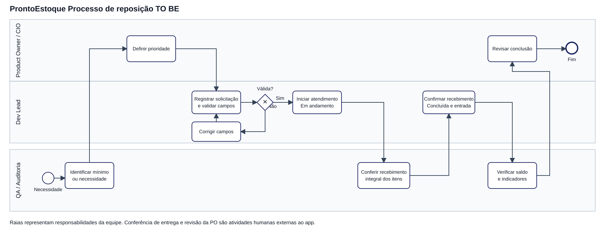

# Processo de reposição de estoque TO BE

Este arquivo mantém o nome pedido no exercício para facilitar a avaliação. O domínio continua sendo estoque: o chamado corresponde a uma solicitação de reposição vinculada a um produto cadastrado.

## BPMN com raias da RACI

[BPMN 2.0 editável com coordenadas de diagrama](processo-estoque.bpmn) e [prévia SVG](processo-estoque.svg). Os dois arquivos são gerados por `scripts/gerar_processo.py`.

As raias têm exatamente os papéis agrupados da RACI: **Product Owner / CIO**, **Dev Lead** e **QA / Auditoria**. Isabella ocupa o primeiro papel, Guilherme e Ruan o segundo e Natan e Max o terceiro. O diagrama representa as responsabilidades da equipe sobre o fluxo acadêmico. Operadores reais são os usuários finais; não há autenticação que vincule um clique a um papel da RACI.

## Fluxo e regras

1. QA identifica um produto abaixo do mínimo ou uma necessidade informada pelo operador.
2. PO define a prioridade de reposição, em atividade humana.
3. Dev apoia o registro da solicitação no sistema. Produto deve existir, solicitante é obrigatório e quantidade é inteira positiva até um bilhão. Falhas retornam ao formulário para correção.
4. A solicitação nasce Aberta. Ao iniciar o atendimento, passa para Em andamento, sem alterar o saldo.
5. QA confere o recebimento integral fora do sistema. Enquanto a entrega não chegou, a solicitação permanece Em andamento. O protótipo não gerencia compras nem recebimento parcial.
6. Dev apoia a confirmação do recebimento. O app grava Concluída, a entrada de estoque e o histórico na mesma transação.
7. QA verifica saldo, histórico e indicadores. PO revisa a conclusão como atividade humana. Essa revisão não é uma aprovação automática do sistema nem o aceite formal do projeto.

| Estado | Próximo permitido | Efeito no estoque |
| --- | --- | --- |
| Aberta | Em andamento | nenhum |
| Em andamento | Concluída | uma entrada integral da quantidade solicitada |
| Concluída | nenhum | reenvio ou avanço bloqueado com 409 |

Cada atualização exige responsável fictício no protótipo e registra hora UTC. O estado enviado pelo formulário deve coincidir com o atual no banco; caso contrário, é necessário recarregar a página. A prioridade não substitui o status. Situação de estoque, Regular ou Abaixo do mínimo, é calculada a partir do saldo e não é editada manualmente.
